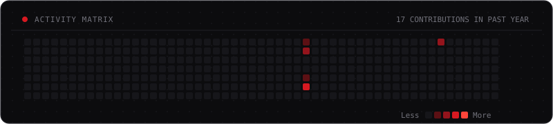

<!-- ANIMATED BOOT SCREEN -->

<!-- TYPING STATUS PROMPT -->

  <samp>DHAKA, BANGLADESH</samp>

---

### `ABOUT`

I'm a developer in progress, experimenting with code, AI-assisted development, and SaaS ideas.

Still learning, still building, still debugging.

---

### `CURRENT PROCESS`

| Area | Focus | State |
| :--- | :--- | :--- |
| **JavaScript** | Core runtime mechanics and asynchronous fundamentals | `IN PROGRESS` |
| **AI Workflows** | High-leverage prompt engineering and system design | `ACTIVE` |
| **Full-Stack** | Connecting responsive client interfaces to APIs and databases | `EXPLORING` |
| **Software Engineering** | Writing modular, maintainable, and verifiable code | `BUILDING` |

---

### `TOOLKIT`

**Languages & Web**  
      

**Databases & Backend**  
    

**AI & Development Tools**  
     

*Familiar with these technologies; continually refining how to build well with them.*

---

### `OFFLINE MODE`

When disconnected from the terminal: tinkering with mechanical keyboards, exploring niche fragrance accords, or revisiting classic PC games.

---

### `ACTIVITY`

  

 

  <samp><strong>NOT FINISHED. NOT STANDING STILL.</strong></samp>

