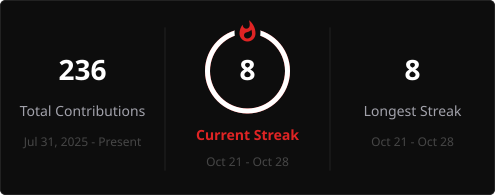

<!-- ANIMATED BOOT SCREEN -->

<!-- TYPING TERMINAL PROMPT -->

---

### `IDENTITY`

> **`DEVELOPER`** : In progress, experimenting with code, AI-assisted workflows, and SaaS ideas.  
> **`FOCUS`** : Still learning, still building, still debugging.

---

### `ACTIVE THREADS`

| Area | Focus | State |
| :--- | :--- | :--- |
| **JavaScript** | Core asynchronous runtime mechanics and language fundamentals | `IN PROGRESS` |
| **AI Workflows** | High-leverage prompt engineering and automated agent workflows | `ACTIVE` |
| **Full-Stack** | Connecting responsive client interfaces to APIs and databases | `EXPLORING` |
| **Software Eng.** | Architectural modularity, code cleanliness, and QA verification | `BUILDING` |

---

### `TOOLKIT MATRIX`

**Languages & Web**  
      

**Databases & Backend**  
    

**AI & Development Tools**  
     

*Familiar with these technologies; continually refining how to build well with them.*

---

### `OFFLINE MODE`

When disconnected from the terminal: tinkering around custom mechanical switches, exploring perfumes, or revisiting classic PC games.

---

### `TELEMETRY`

  
  &nbsp;
  

 

  <samp><strong>NOT FINISHED. NOT STANDING STILL.</strong></samp>

